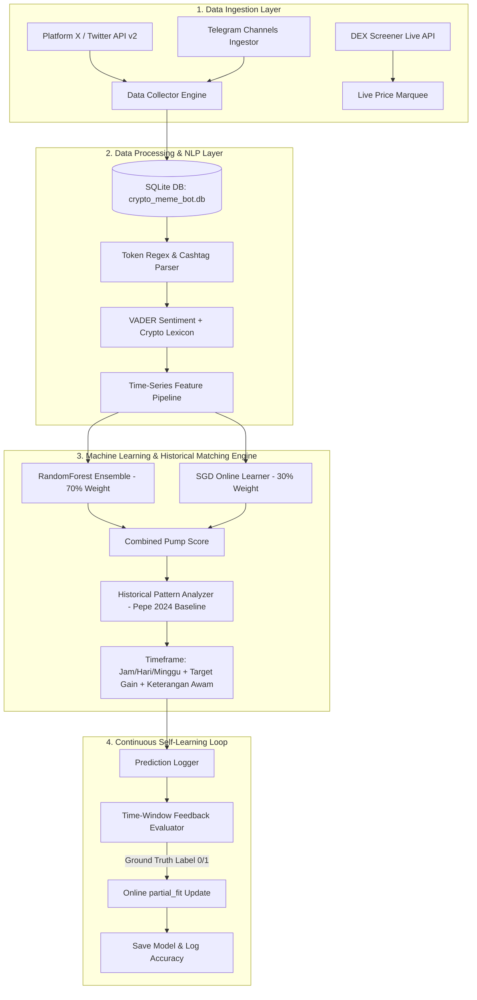

# 📖 BUKU PANDUAN MANUAL (MANUAL BOOK)
## MemeCoin ML Trend & Prediction Bot

---

## 📑 DAFTAR ISI
1. [Pendahuluan & Ringkasan Sistem](#1-pendahuluan--ringkasan-sistem)
2. [Cara Kerja Sistem Prediksi Trend Meme Coin](#2-cara-kerja-sistem-prediksi-trend-meme-coin)
   - [2.1 Data Ingestion Layer (Pengumpulan Data Multi-Sumber)](#21-data-ingestion-layer-pengumpulan-data-multi-sumber)
   - [2.2 Feature Engineering & Natural Language Processing (NLP)](#22-feature-engineering--natural-language-processing-nlp)
   - [2.3 Machine Learning Engine (Strategi Dual-Model)](#23-machine-learning-engine-strategi-dual-model)
   - [2.4 Analisis Pola Histori Kenaikan (+50% & +100%+ Baseline PEPE 2024)](#24-analisis-pola-histori-kenaikan-50--100-baseline-pepe-2024)
   - [2.5 Continuous Self-Learning Loop (Mekanisme Umpan Balik Mandiri)](#25-continuous-self-learning-loop-mekanisme-umpan-balik-mandiri)
3. [Penjelasan Fitur Tampilan Hasil Pada Halaman (Web Dashboard)](#3-penjelasan-fitur-tampilan-hasil-pada-halaman-web-dashboard)
   - [3.1 Navigation Header & Live Status Bar](#31-navigation-header--live-status-bar)
   - [3.2 DEX Screener Realtime Marquee Banner](#32-dex-screener-realtime-marquee-banner)
   - [3.3 Kartu Ringkasan Metrik Utama (Top Metrics Cards)](#33-kartu-ringkasan-metrik-utama-top-metrics-cards)
   - [3.4 Section 3 Koin Rekomendasi Teratas Untuk Dibeli](#34-section-3-koin-rekomendasi-teratas-untuk-dibeli)
   - [3.5 Section Fitur Pembantu (Token Inspector, Live Feed & ML Log di Atas Tabel)](#35-section-fitur-pembantu-token-inspector-live-feed--ml-log-di-atas-tabel)
   - [3.6 Tabel Peringkat Prediksi Koin Meme (Predicted Meme Coin Pump Rankings)](#36-tabel-peringkat-prediksi-koin-meme-predicted-meme-coin-pump-rankings)
4. [Panduan Operasional & Interpretasi Rekomendasi](#4-panduan-operasional--interpretasi-rekomendasi)
5. [Glosarium Istilah (Glossary)](#5-glosarium-istilah-glossary)

---

## 1. PENDAHULUAN & RINGKASAN SISTEM

**MemeCoin ML Trend & Prediction Bot** adalah sistem analitik berbasis *Machine Learning* (ML) dan *Natural Language Processing* (NLP) yang dirancang untuk memantau, menganalisis, dan memprediksi potensi kenaikan lonjakan harga/volume (*pump prediction*) dari koin-koin meme (*meme coins*) secara *real-time*.

Sistem ini mengintegrasikan data aktivitas percakapan dari **Platform X (Twitter)**, saluran komunitas **Telegram**, serta harga dan fluktuasi pasar dari **DEX Screener**. Melalui pendekatan *Continuous Self-Learning* dan *Historical Pattern Benchmark Analysis*, sistem secara otomatis mencocokkan akumulasi percakapan media sosial terkini dengan pola histori rali koin meme legendaris (seperti PEPE Feb & Mei 2024) untuk memberikan estimasi rentang waktu kenaikan (beberapa jam, 1-3 hari, atau 1-2 minggu ke depan) dalam bahasa yang sangat mudah dipahami oleh orang awam.

---

## 2. CARA KERJA SISTEM PREDIKSI TREND MEME COIN

Sistem bekerja melalui 4 tahapan berkesinambungan (*end-to-end pipeline*) yang memproses data mentah menjadi rekomendasi keputusan presisi.



---

## 3. PENJELASAN FITUR TAMPILAN HASIL PADA HALAMAN (WEB DASHBOARD)

Dashboard antarmuka web dibangun menggunakan gaya desain modern **Glassmorphism Dark Mode** yang responsif dan terstruktur rapi.


---

### 3.1 Navigation Header & Live Status Bar
- **Logo & Judul (`MEMEBOT ML`)**: Identitas utama sistem pencari koin meme.
- **`LIVE SCANNER` Badge**: Indikator lampu hijau berkedip yang menandakan engine pemindai data sedang aktif secara *real-time*.
- **`ML Samples Trained` Counter**: Menampilkan total sampel data historis & *feedback loop* yang telah dipelajari model ML.

---

### 3.2 DEX Screener Realtime Marquee Banner
- **Fungsi**: Ticker berita berjalan (*scrolling marquee*) yang menampilkan harga USD dan persentase perubahan 24 jam koin meme secara *live* dari DEX Screener API.

---

### 3.3 Kartu Ringkasan Metrik Utama (Top Metrics Cards)
1. **📊 Monitored Meme Coins**: Jumlah koin meme yang masuk dalam pemantauan aktif (15 token).
2. **🔥 Top Pump Prediction**: Nama koin meme yang menempati peringkat #1 dengan probabilitas *pump* paling tinggi saat ini.
3. **🌐 Data Sources**: Sumber data aktif (*Platform X + Telegram*).
4. **🔄 Self-Learning Engine**: Status keaktifan algoritma pembelajaran berkelanjutan (*SGD + Continuous ML*).

---

### 3.4 Section 3 Koin Rekomendasi Teratas Untuk Dibeli
- **Fungsi**: Menyajikan **3 Koin Meme Teratas yang Sangat Direkomendasikan Untuk Dibeli** berdasarkan skor ML tertinggi & kemiripan pola histori lonjakan harga.
- **Elemen Kartu**: Simbol Token, Target Kenaikan (`+50% s/d +100%+`), Badge Waktu (`⏱️ 6-24 Jam`, `⏱️ 1-3 Hari`, `⏱️ 1-2 Minggu`), dan Keterangan Ringkas Awam.

---

### 3.5 Section Fitur Pembantu (Token Inspector, Live Feed & ML Log di Atas Tabel)
Sesuai dengan struktur wireframe layout yang baru ([index.html#L89-L151](file:///c:/Users/ASUS%20A416F/OneDrive/Documents/tools_py/BOTmemeco/dashboard/templates/index.html#L89-L151)):

```
┌────────────────────────────────────────────────────────────────────────┐
│                        🔍 Token Inspector                              │
│                    (Pencarian Full-Width di Atas)                      │
├───────────────────────────────────┬────────────────────────────────────┤
│  💬 Live Social Ingestion Feed    │     🧠 ML Self-Learning Log        │
│     (Kolom Kiri Sub-Grid)         │       (Kolom Kanan Sub-Grid)       │
└───────────────────────────────────┴────────────────────────────────────┘
```

1. **Top Panel (Full-Width)**: `Token Inspector` (Pencarian & Inspeksi Instan ML per Ticker Token).
2. **Bottom Left Column**: `Live Social Ingestion Feed` (Stream Postingan Masuk Real-Time dari X & Telegram).
3. **Bottom Right Column**: `ML Self-Learning Log` (Catatan Transparansi Evaluasi Accuracy & Update Bobot `partial_fit`).

---

### 3.6 Tabel Peringkat Prediksi Koin Meme (Predicted Meme Coin Pump Rankings)
Terletak **di bawah** Section Fitur Pembantu secara *full-width* ([index.html#L153-L188](file:///c:/Users/ASUS%20A416F/OneDrive/Documents/tools_py/BOTmemeco/dashboard/templates/index.html#L153-L188)):

#### Penjelasan Kolom Tabel (10 Kolom):
1. **Rank**: Posisi peringkat koin (`#1`, `#2`, dll).
2. **Coin**: Simbol koin meme bersangkutan (`$PEPE`, `$DOGE`, dll).
3. **Pump Prob (%)**: Persentase estimasi probabilitas kenaikan harga dengan Visual Progress Bar.
4. **Recommendation**: Label keputusan aksi (`STRONG BUY 🚀`, `BULLISH 📈`, `NEUTRAL ⚡`, `BEARISH 📉`).
5. **Estimasi Waktu & Target**: Estimasi rentang waktu kenaikan (beberapa jam / hari / minggu ke depan) beserta estimasi target persentase kenaikan harga (+50%, +100%+).
6. **Keterangan (Ringkasan Awam)**: Penjelasan kondisi percakapan koin dalam kalimat sederhana yang mudah dipahami orang awam.
7. **1h Vol**: Jumlah postingan dalam 1 jam terakhir.
8. **24h Vol**: Akumulasi postingan 24 jam terakhir.
9. **Vol Velocity**: Persentase laju percepatan volume postingan ($\Delta V$).
10. **Avg Sent**: Skor rata-rata sentimen percakapan (-1.00 s/d +1.00).

---

## 4. PANDUAN OPERASIONAL & INTERPRETASI REKOMENDASI

| Skenario Dashboard | Target Gain & Waktu Kenaikan | Keterangan Bahasa Awam | Rekomendasi Aksi |
| :--- | :--- | :--- | :--- |
| **High Momentum (Pola PEPE Mei 2024)** | `+100%+` dalam **1 - 2 Minggu Ke Depan** | Sangat Bullish! Perbincangan naik pesat dengan sentimen sangat positif. Berpotensi meroket +100%+ dalam 1-2 minggu. | **Rekomendasi Utama (Buy & Hold)** |
| **Akumulasi Ramai (Pola Rali PEPE Feb 2024)** | `+50% s/d +80%` dalam **1 - 3 Hari Ke Depan** | Sinyal Akumulasi Positif. Perbincangan komunitas di X & Telegram mulai ramai. Berpotensi naik +50%+ dalam 1-3 hari. | **Beli / Accumulate** |
| **Scalp Quick Surge** | `+20% s/d +40%` dalam **6 - 24 Jam Ke Depan** | Pergerakan Jangka Pendek Stabil. Terdeteksi respon awal perbincangan. Berpotensi naik cepat dalam 6-24 jam. | **Pantau / Quick Scalp** |
| **Netral / Sideways** | `0% s/d +15%` (Netral / Standby) | Aktivitas perbincangan cenderung normal dan stabil. Belum ada sinyal lonjakan besar. | **Wait & See** |
| **Waspada Penurunan (FUD)** | `Risk Drop (-10% s/d -30%)` | Waspada! Perbincangan didominasi sentimen negatif/FUD. Dikhawatirkan terjadi penurunan harga. | **Hindari / Jual** |

---

## 5. GLOSARIUM ISTILAH (GLOSSARY)

1. **Token Inspector**: Fitur pencarian instan untuk menganalisis koin tertentu.
2. **Live Feed**: Aliran cuitan & pesan telegram terkini.
3. **ML Self-Learning Log**: Catatan riwayat akurasi pembelajaran mandiri algoritma ML.

---
*Buku Panduan Manual ini disesuaikan dengan struktur tata letak elemen terbaru.*
