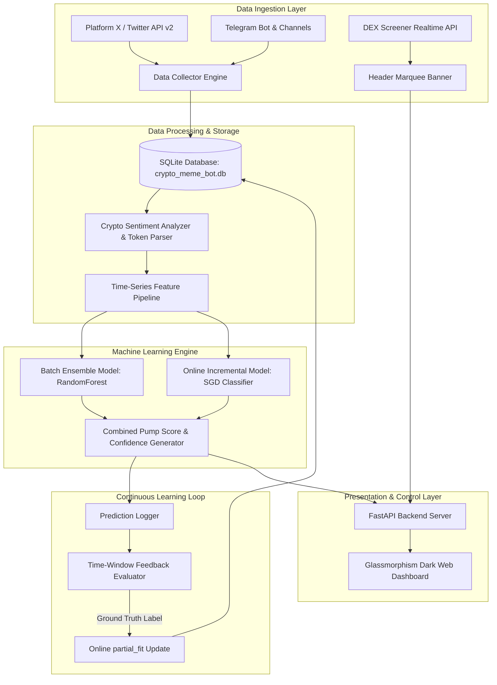
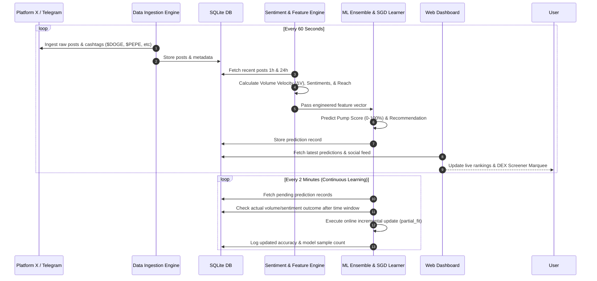

# 🚀 MemeCoin ML Trend & Prediction Bot

Bot cerdas berbasis Machine Learning untuk mengumpulkan data postingan dari **Platform X (Twitter)**, **Telegram Channels**, dan **DEX Screener** secara real-time untuk memprediksi kenaikan koin meme (*meme coin pump prediction*). Sistem dilengkapi dengan mekanisme **Continuous Self-Learning** yang memungkinkan model ML terus belajar dari data baru dan hasil evaluasi secara mandiri.

---

## 📊 Alur Kerja Sistem (System Architecture & Workflow)



---

## 📋 Diagram Alur Sekuensial Data (Sequence Diagram)



---

## 📁 Struktur Proyek (Project Directory)

```
BOTmemeco/
├── .env                       # File konfigurasi API Key (Twitter, Telegram, Port)
├── config.py                  # Konfigurasi parameter sistem & crypto lexicon
├── requirements.txt           # File dependensi Python (scikit-learn, fastapi, uvicorn, dll)
├── main.py                    # Main Entry Point (Menjalankan Ingestion Loop, ML & Web Server)
├── crypto_meme_bot.db         # Database SQLite utama
│
├── ingestion/                 # Modul Pengambil Data (Data Collection Layer)
│   ├── __init__.py
│   ├── database.py            # SQLite Database Manager & CRUD operations
│   ├── data_collector.py     # Orchestrator Pengumpul Data X & Telegram
│   ├── x_collector.py         # Twitter/X API v2 Ingestor + Simulation Fallback
│   ├── telegram_collector.py  # Telegram Channel Ingestor + Simulation Fallback
│   └── dexscreener_collector.py # DEX Screener Real-time Price & Liquidity Collector
│
├── engine/                    # Modul NLP & Feature Engineering
│   ├── __init__.py
│   ├── token_extractor.py     # Parser regex simbol cashtag ($DOGE), hashtag (#PEPE)
│   ├── sentiment_analyzer.py  # VADER Sentiment disesuaikan dengan bahasa gaul crypto
│   └── feature_pipeline.py    # Kalkulator rasio kecepatan volume (ΔV) & social reach
│
├── ml/                        # Modul Machine Learning & Self-Learning
│   ├── __init__.py
│   ├── model_manager.py       # Model RandomForest Ensemble & SGD Incremental Learner
│   └── continuous_learner.py  # Self-Learning loop, evaluasi ground-truth, partial_fit
│
├── dashboard/                 # Antarmuka Web Dashboard (FastAPI + HTML/CSS/JS)
│   ├── __init__.py
│   ├── app.py                 # Endpoint REST API (/api/trending, /api/dexscreener, dll)
│   ├── templates/
│   │   └── index.html         # Template Dashboard Glassmorphism UI
│   └── static/
│       ├── style.css          # Styling CSS Dark Mode + Animasi Marquee DEX Screener
│       └── main.js            # Logika Frontend JS & Auto-Refresh Ticker
│
└── tests/                     # Suite Pengujian Otomatis
    └── test_all.py            # Unit test database, NLP, feature pipeline & ML
```

---

## 🛠️ Penjelasan Modul & Parameter Utama

### 1. Feature Engineering Engine (`engine/feature_pipeline.py`)
Fitur-fitur numerik yang diekstrak dari postingan media sosial untuk dilatih oleh ML:

| Fitur | Deskripsi | Formula / Logika |
| :--- | :--- | :--- |
| `post_count_1h` | Jumlah postingan koin dalam 1 jam terakhir | Count($\text{Posts}_{1h}$) |
| `post_count_24h` | Jumlah postingan koin dalam 24 jam terakhir | Count($\text{Posts}_{24h}$) |
| `volume_velocity` ($\Delta V$) | Kecepatan lonjakan volume postingan | $\frac{V_{1h} - V_{prev\_1h}}{V_{prev\_1h} + 1}$ |
| `avg_sentiment` | Rata-rata skor sentimen postingan (-1.0 s/d +1.0) | Mean($\text{VaderScore}$) |
| `bullish_ratio` | Persentase postingan bersentimen sangat positif | $\frac{\text{Posts}_{score \ge 0.15}}{\text{Total Posts}}$ |
| `social_reach_score` | Bobot jangkauan sosial (volume + penulis unik + engagement) | $(V_{1h} \times 1.5) + (\text{Authors}_{1h} \times 2.0) + (\text{Engagement} \times 0.1)$ |
| `x_ratio` | Proporsi sumber postingan dari X vs Telegram | $\frac{\text{Posts}_X}{\text{Total Posts}}$ |

### 2. Machine Learning Pipeline & Continuous Learning (`ml/`)
- **Dual Learning Strategy**:
  - **Batch Ensemble (`RandomForestClassifier`)**: Memberikan bobot prediksi global dari pola historis jangka panjang.
  - **Online Incremental Learner (`SGDClassifier`)**: Melakukan pembaruan bobot (*weights update*) secara langsung menggunakan fungsi `partial_fit` saat data dan hasil evaluasi baru tiba.
- **Continuous Feedback Loop**:
  - Sistem merekam prediksi awal.
  - Setelah jeda waktu, sistem memeriksa apakah volume/sentimen koin tersebut benar-benar meningkat (Label = 1) atau tidak (Label = 0).
  - Melakukan pembaruan model secara otomatis dan mencatat akurasi di tabel `model_logs`.

## ⚡ Cara Menjalankan Bot

### 1. Persyaratan Sistem
- Python 3.10+
- Pip & Virtual Environment (opsional)

### 2. Instalasi Dependensi
```bash
pip install -r requirements.txt
```

### 3. Mengatur Konfigurasi (.env)
Buka file `.env` dan atur kunci API Anda:
```env
TWITTER_CONSUMER_KEY=KUNCI_X_ANDA
TWITTER_CONSUMER_SECRET=SECRET_X_ANDA
TWITTER_BEARER_TOKEN=BEARER_TOKEN_X_ANDA
TELEGRAM_BOT_TOKEN=TOKEN_TELEGRAM_ANDA

PORT=3000
FETCH_INTERVAL_SECONDS=60
```

### 4. Menjalankan Bot & Web Dashboard
```bash
python main.py
```

Buka browser Anda dan akses Web Dashboard:
👉 **[http://127.0.0.1:3000](http://127.0.0.1:3000)** (atau port lain jika port 3000 sedang digunakan).

### 5. Menjalankan Pengujian Otomatis
```bash
python tests/test_all.py
```
